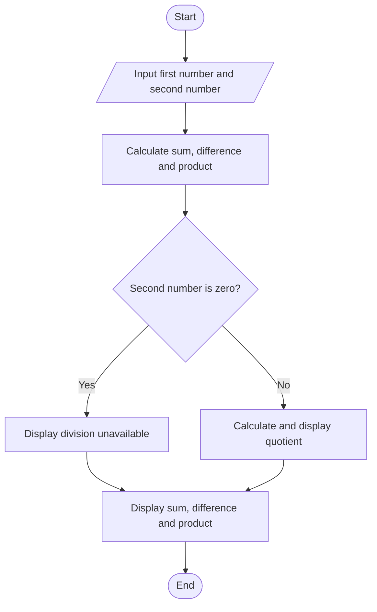
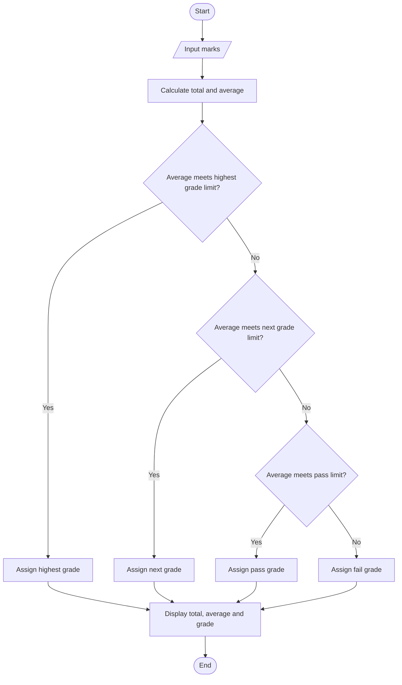
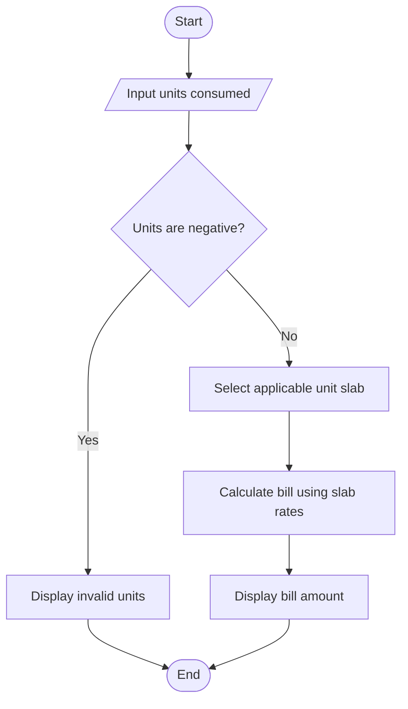
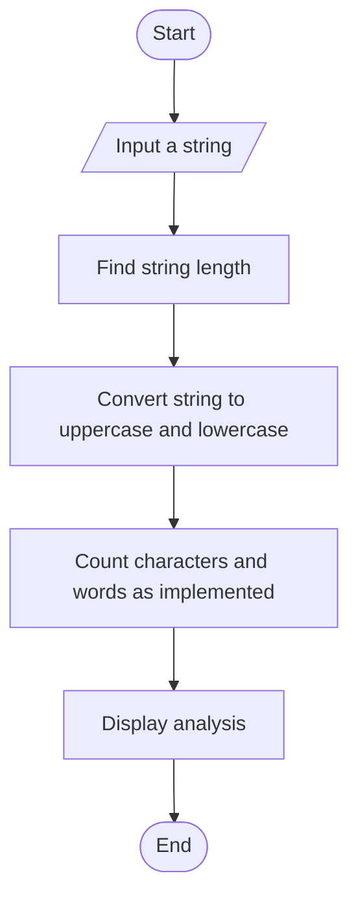
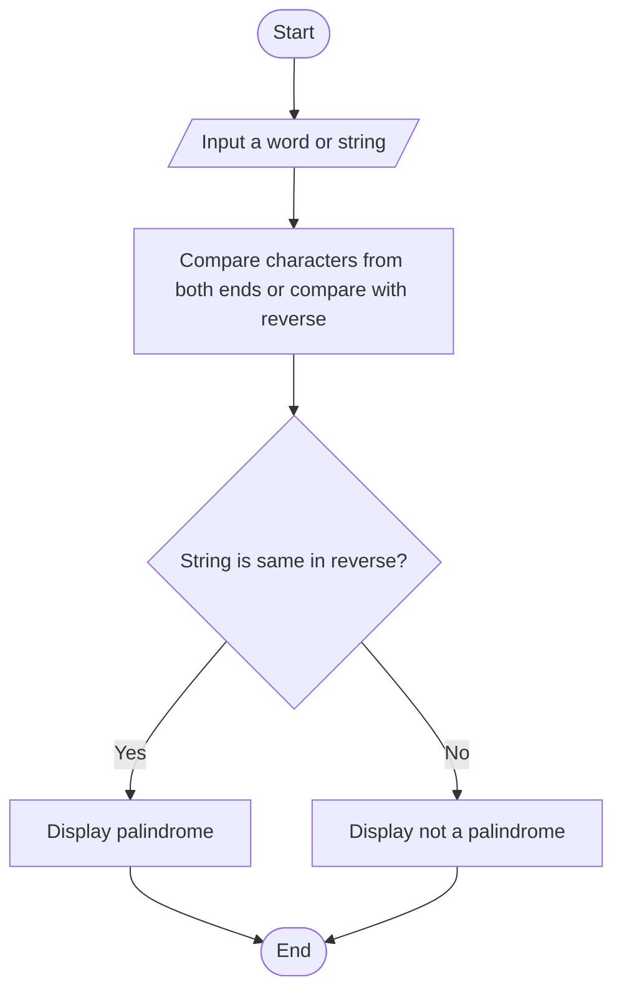
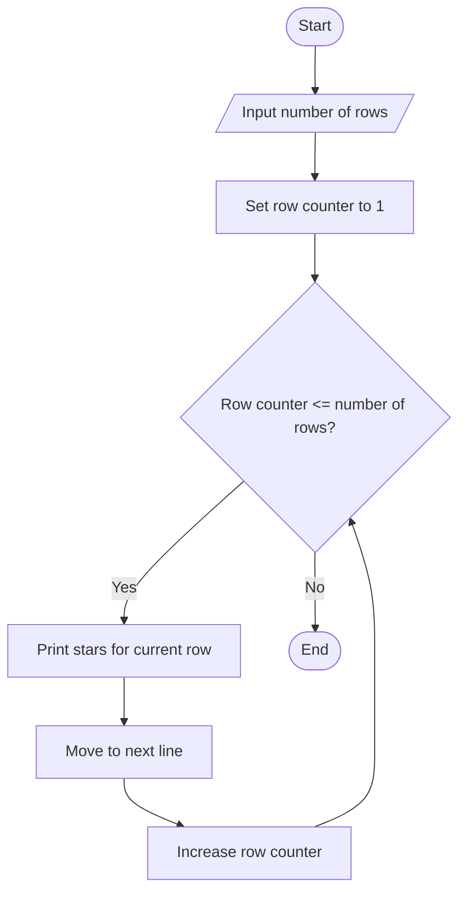
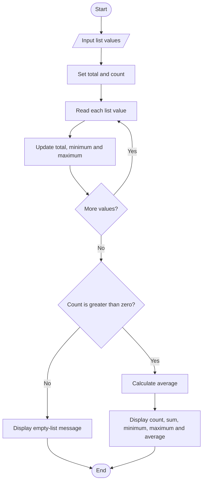
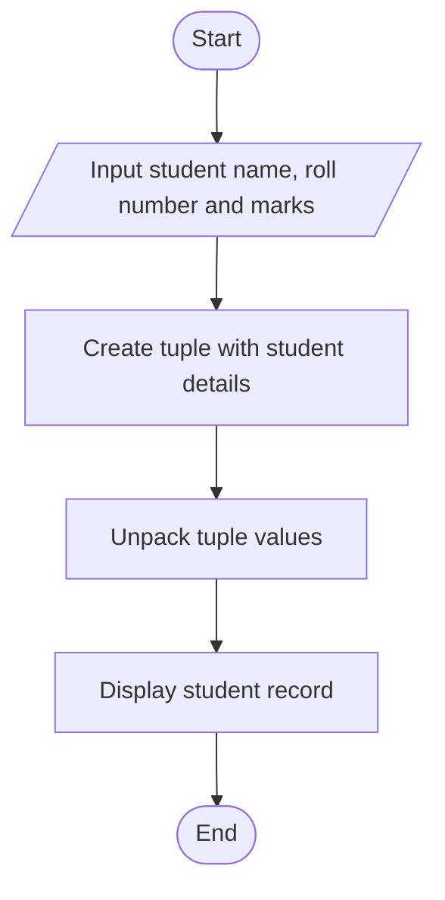
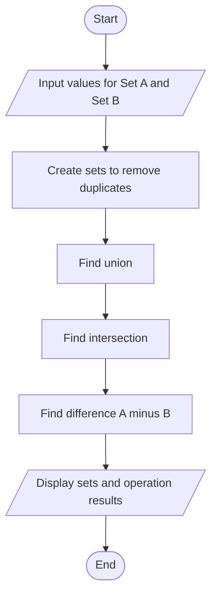

# Python ABL Assignment — Flowcharts

This document contains a flowchart for each of the 10 case studies. The diagrams use Mermaid, which GitHub renders directly. The steps stay within the basic Unit I–III topics used by this assignment: input/output, variables, type conversion, arithmetic, conditional statements, loops, strings, lists, tuples and sets.

## 1. Simple Arithmetic Calculator



## 2. Student Marks and Grade Calculator



## 3. Electricity Bill Calculator



## 4. Temperature Converter

```mermaid
flowchart TD
    A([Start]) --> B[/Choose conversion direction/]
    B --> C{Celsius to Fahrenheit?}
    C -- Yes --> D[/Input Celsius value/]
    D --> E[ Fahrenheit = Celsius * 9 / 5 + 32 ]
    C -- No --> F[/Input Fahrenheit value/]
    F --> G[ Celsius = (Fahrenheit - 32) * 5 / 9 ]
    E --> H[Display converted temperature]
    G --> H
    H --> I([End])
```

## 5. String Analyzer



## 6. Palindrome Checker



## 7. Star Pattern Generator



## 8. List Statistics Calculator



## 9. Student Record Using Tuples



## 10. Set Operations and Duplicate Removal



## Notes

- These are algorithm-level flowcharts describing the intended case-study steps.
- Where a project offers fewer options (for example, only one temperature conversion direction), follow the actual program's supported behavior.
- The diagrams describe the logic; they are not evidence that a new execution or screenshot capture was performed.
